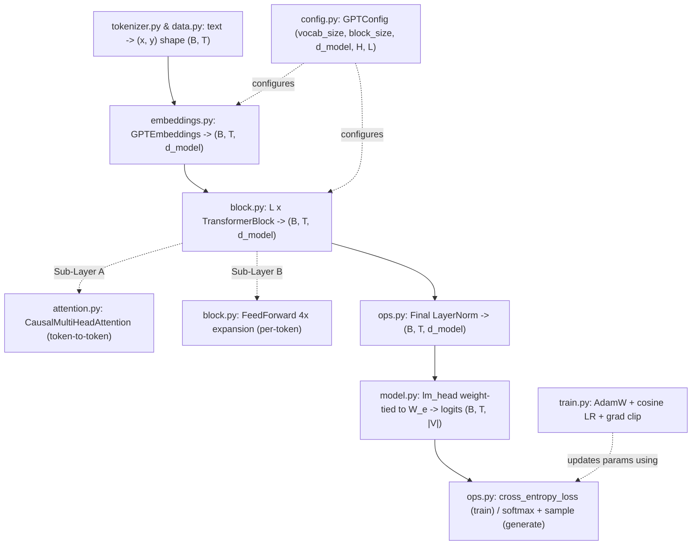

# GPT From Scratch — Top-to-Bottom Module Walkthrough

This guide walks through the entire **870-line first-principles GPT** top-to-bottom — starting from the macro `GPT` model and peeling back one abstraction layer at a time down to raw tensor math, then closing with the training and data pipeline.

---

## 0. Architecture & Module Map



**Shape convention used everywhere:**
- `B` = batch size (number of independent sequences processed in parallel)
- `T` = sequence length (`T <= block_size`)
- `d_model` = residual stream width
- `H` = number of attention heads (`n_heads`), with per-head width `d_k = d_model // H`
- `|V|` = vocabulary size (`vocab_size`)

---

## 1. [`src/gpt/model.py`](src/gpt/model.py) — The Macro Pipeline (`GPT`)

`GPT` is the top-level orchestrator implementing the Pre-LayerNorm GPT-2 macro pipeline.

### Wiring & Initialization ([`__init__`](src/gpt/model.py#L25-L56))
1. **`self.embeddings`**: Converts `(B, T)` integer IDs into `(B, T, d_model)` continuous vectors.
2. **`self.blocks`**: `nn.ModuleList` of `L` identical `TransformerBlock` layers. Every block preserves the exact shape `(B, T, d_model)` so blocks compose cleanly.
3. **`self.final_ln`**: Stabilizes the residual stream after `L` un-normalized residual additions accumulate across depth.
4. **`self.lm_head`**: `Linear(d_model, vocab_size, bias=False)` projects each contextualized token vector $h$ onto vocabulary logits $z_i = h \cdot W_e[i]$.
5. **Weight tying** ([L45-L46](src/gpt/model.py#L45-L46)): `self.lm_head.weight = self.embeddings.token_embedding.weight`. Both input lookup and output scoring share the exact same $|V| \times d_{\text{model}}$ matrix, aligning input/output token geometry and saving $|V| \cdot d_{\text{model}}$ parameters.
6. **GPT-2 residual scaling** ([`_apply_gpt2_residual_init`](src/gpt/model.py#L52-L56)): Scales `attn.out_proj.weight` and `ffn.fc2.weight` initial std to $0.02 / \sqrt{2L}$. Because `L` blocks add `2L` residual branches to the stream, dividing by $\sqrt{2L}$ keeps initial stream variance independent of depth.

### Training Forward Pass ([`forward`](src/gpt/model.py#L58-L88))
```text
idx: (B, T)
  -> embeddings      : (B, T, d_model)
  -> L x blocks      : (B, T, d_model)
  -> final_ln        : (B, T, d_model)
  -> lm_head         : (B, T, |V|)     [raw logits]
  -> cross_entropy   : scalar loss     [if targets provided]
```
In a single forward pass, all `B * T` positions predict their respective next token in parallel. At initialization, random small weights produce near-uniform probabilities $1/|V|$, so healthy initial loss starts right around $\ln(|V|)$ (`ln(65) ≈ 4.174`).

### Autoregressive Generation ([`generate`](src/gpt/model.py#L98-L168))
Runs under `@torch.no_grad()` in `eval()` mode (restoring the prior `train/eval` flag in a `finally:` block). Each loop iteration appends **one** new token:
1. **Crop context** ([L129](src/gpt/model.py#L129)): `idx_cond = idx[:, -block_size:]` so position indices never exceed the learned positional table.
2. **Take last position only** ([L132-L133](src/gpt/model.py#L132-L133)): `next_logits = logits[:, -1, :]` of shape `(B, |V|)` — only the final position predicts token `T + 1`.
3. **Decode / Sample** ([L135-L161](src/gpt/model.py#L135-L161)):
   - **Greedy**: `argmax` (deterministic, but prone to repetition loops).
   - **Temperature (`logits / T`)**:
     - As $T \to 0^+$, differences between logits blow up → `softmax` collapses to a one-hot spike on the top token (approaches greedy).
     - As $T \to \infty$, all logits shrink toward `0` → `softmax` approaches a flat uniform distribution (pure randomness).
   - **Top-$k$**: Sets all logits below the $k$-th largest to $-\infty$ before `softmax`.
   - **Top-$p$ (nucleus)**: Sorts probabilities descending, keeps the smallest prefix whose cumulative probability reaches $p$ (always preserving the top-1 token), and masks the tail to $-\infty$.
4. **Append & repeat** ([L164](src/gpt/model.py#L164)): `idx = torch.cat([idx, next_token], dim=1)`.

---

## 2. [`src/gpt/block.py`](src/gpt/block.py) — One Transformer Block (`TransformerBlock` & `FeedForward`)

### [`TransformerBlock`](src/gpt/block.py#L34-L57)
```python
x = x + self.attn(self.ln1(x))  # Sub-Layer A: Token-to-token communication
x = x + self.ffn(self.ln2(x))   # Sub-Layer B: Per-token feature computation
```
- **Why Pre-LayerNorm (`ln` inside the branch, not around the `+`)?** The skip path stays completely untouched from `Layer 1` to `Layer L`. During backpropagation, $\frac{\partial (x + f(x))}{\partial x} = I + \frac{\partial f}{\partial x}$ gives gradients a direct identity highway straight to early layers without shrinking or exploding.
- **Division of labor**: Attention **moves** information *between* tokens; the FFN **transforms** information *inside* each token independently.

### [`FeedForward`](src/gpt/block.py#L11-L31)
```text
x: (B, T, d_model)
  -> fc1     : (B, T, 4 * d_model)   [expand into wider feature space]
  -> GELU    : (B, T, 4 * d_model)   [smooth non-linearity]
  -> fc2     : (B, T, d_model)       [project back to residual stream]
  -> dropout : (B, T, d_model)
```
- Without `GELU`, `fc2(fc1(x))` would collapse algebraically into a single linear matrix multiplication.
- Parameter share: Attention weights are $4 d_{\text{model}}^2$ (`qkv_proj` = $3d^2$, `out_proj` = $d^2$), while FFN weights are $8 d_{\text{model}}^2$ (`fc1` = $4d^2$, `fc2` = $4d^2$). Roughly **2/3 of a GPT's parameters live in the FFN**.

---

## 3. [`src/gpt/attention.py`](src/gpt/attention.py) — Masked Multi-Head Self-Attention

Contains two classes:
- [`SingleHeadCausalAttention`](src/gpt/attention.py#L12-L67): Educational single-head reference with explicit separate `w_q`, `w_k`, `w_v`.
- [`CausalMultiHeadAttention`](src/gpt/attention.py#L70-L138): The fused multi-head layer used inside `TransformerBlock` (verified in tests to be numerically identical to concatenating $H$ single heads + `out_proj`).

### Step-by-Step Shape Trace ([`forward`](src/gpt/attention.py#L97-L138))
1. **Fused QKV projection** ([L107-L108](src/gpt/attention.py#L107-L108)):
   `Linear(d_model -> 3 * d_model)` maps `(B, T, d_model) -> (B, T, 3*d_model)`, then `.chunk(3, dim=-1)` splits into `q`, `k`, `v`.
2. **Split into $H$ parallel heads** ([L112-L114](src/gpt/attention.py#L112-L114)):
   `.view(B, T, H, d_k).transpose(1, 2)` reshapes `q, k, v` to `(B, H, T, d_k)`. Moving `H` before `T` lets PyTorch run all `B * H` attention matrices in one batched matmul.
3. **First Matmul — Scaled affinity scores** ([L117](src/gpt/attention.py#L117)):
   `scores = (q @ k.transpose(-2, -1)) / sqrt(d_k)` → `(B, H, T, T)`.
   Dividing by $\sqrt{d_k}$ keeps pre-softmax variance $\approx 1$ (since summing $d_k$ products scales variance by $d_k$), preventing softmax saturation and vanishing gradients.
4. **Causal Look-Ahead Mask** ([L120-L121](src/gpt/attention.py#L120-L121)):
   Uses a precomputed lower-triangular boolean buffer `causal_mask` (`j <= i`) and overwrites future entries (`j > i`) with `-inf` **before** `softmax`. Doing it *before* `softmax` removes future tokens from the softmax denominator $\sum_k e^{s_k}$ completely — zero future leakage and rows still sum to `1.0`.
5. **Softmax & Attention Dropout** ([L124-L125](src/gpt/attention.py#L124-L125)):
   `weights = softmax(scores, dim=-1)` turns `-inf` into exact `0.0`; `attn_dropout` randomly drops attention links during training.
6. **Second Matmul — Weighted value blend** ([L128](src/gpt/attention.py#L128)):
   `head_out = weights_dropped @ v` → `(B, H, T, d_k)`.
7. **Concatenate & Output Projection** ([L132-L135](src/gpt/attention.py#L132-L135)):
   `.transpose(1, 2).contiguous().view(B, T, d_model)` concatenates all $H$ heads, then `out_proj` (`Linear(d_model, d_model)`) mixes insights *across* heads before `resid_dropout`.

> [!NOTE]
> **Why KV Caching speeds up production inference:** Because causal attention never lets past tokens attend to future tokens, the Key ($K$) and Value ($V$) vectors computed for positions `0..t-1` **never change** when token `t` is appended. Storing past `(K, V)` tensors per layer lets each decode step run only the single new token (`T = 1`) through the model instead of re-encoding all `T` tokens — cutting per-step compute from $O(T^2)$ to $O(T)$.

---

## 4. [`src/gpt/embeddings.py`](src/gpt/embeddings.py) — Entering the Residual Stream (`GPTEmbeddings`)

```python
tok_emb = self.token_embedding(idx)          # (B, T) -> (B, T, d_model)
positions = torch.arange(T, device=idx.device)
pos_emb = self.pos_embedding(positions)      # (T,)   -> (T, d_model)
return self.dropout(tok_emb + pos_emb)       # broadcast add + dropout -> (B, T, d_model)
```
- **Guard**: Explicitly raises `ValueError` if `T > block_size` rather than silently failing on positional lookup.
- **Why add instead of concatenate?** Keeps residual width at `d_model` (avoiding doubling every downstream layer), and in high-dimensional $\mathbb{R}^{d_{\text{model}}}$ the model stores token meaning and position in nearly orthogonal subspaces of the same vector.
- **No cross-token mixing yet**: Right after `GPTEmbeddings`, each token knows *what* it is and *where* it sits, but nothing about its neighbors — that waits for `CausalMultiHeadAttention`.

---

## 5. [`src/gpt/ops.py`](src/gpt/ops.py) — Raw Tensor Primitives (The Bedrock)

Every neural-network layer in the project is built from raw tensor math and `nn.Parameter` here, verified forward **and** backward (`.grad`) against PyTorch's built-ins:

| Primitive | Lines | Exact Math / First-Principles Trick |
|---|---|---|
| `Linear` | [L10-L37](src/gpt/ops.py#L10-L37) | `x @ W^T + b` with $\mathcal{N}(0, 0.02^2)$ init; works on any leading shape `(*, in_features)`. |
| `Embedding` | [L40-L60](src/gpt/ops.py#L40-L60) | Pure row indexing `self.weight[indices]` into $W_e \in \mathbb{R}^{|V| \times d_{\text{model}}}$. |
| `LayerNorm` | [L63-L92](src/gpt/ops.py#L63-L92) | Per-token (`dim=-1`) mean & population variance (`unbiased=False`) so there is zero future leakage across `T` and zero batch-size dependence across `B`; then learnable $\gamma \odot \hat{x} + \beta$. |
| `GELU` | [L95-L113](src/gpt/ops.py#L95-L113) | Exact $\frac{1}{2}x(1 + \operatorname{erf}(x/\sqrt{2}))$ and GPT-2's `tanh` approximation. Smooth curve avoids dead ReLU neurons. |
| `Dropout` | [L116-L134](src/gpt/ops.py#L116-L134) | **Inverted dropout**: masks elements with prob `p` and divides survivors by `1 - p` in `train()` mode so $\mathbb{E}[\text{Dropout}(x)] = x$ and `eval()` needs zero rescaling. |
| `softmax` | [L137-L146](src/gpt/ops.py#L137-L146) | Subtracts $m = \max(z)$ before `exp` so the largest exponent is $e^0 = 1$, eliminating float overflow (`inf/inf = nan`). |
| `log_softmax` | [L149-L158](src/gpt/ops.py#L149-L158) | Computes $(z - m) - \log \sum e^{z - m}$ directly instead of `log(softmax(z))`, preventing `log(0) = -inf` underflow. |
| `cross_entropy_loss` | [L161-L181](src/gpt/ops.py#L161-L181) | Flattens `(B, T, |V|)` → `(B*T, |V|)`, gathers target `log_softmax` entries via integer indexing, and returns the negative mean. |

---

## 6. [`src/gpt/train.py`](src/gpt/train.py) — Optimization & Training Loop

1. **[`configure_optimizer`](src/gpt/train.py#L40-L66)**: Splits trainable parameters into two AdamW groups:
   - `ndim >= 2` (weight matrices in `Linear` and `Embedding`) → `weight_decay = 0.1`
   - `ndim < 2` (1D biases and `LayerNorm` $\gamma, \beta$) → `weight_decay = 0.0` (decaying LayerNorm scales toward 0 fights normalization).
2. **[`get_lr`](src/gpt/train.py#L69-L85)**: Linear warmup from `0` to `max_lr` (stabilizing early Adam momentum estimates), followed by smooth cosine decay down to `min_lr`.
3. **[`estimate_loss`](src/gpt/train.py#L88-L112)**: Averages loss over `eval_iters` batches in `eval()` mode under `@torch.no_grad()`, giving an unbiased signal of generalization vs. overfitting.
4. **[`train_gpt`](src/gpt/train.py#L115-L167)**: Standard step loop: update LR → sample `(x, y)` → `zero_grad(set_to_none=True)` → forward → `loss.backward()` → `clip_grad_norm_(1.0)` (guards against rare gradient spikes) → `optimizer.step()`.

---

## 7. [`src/gpt/data.py`](src/gpt/data.py), [`src/gpt/tokenizer.py`](src/gpt/tokenizer.py) & [`src/gpt/config.py`](src/gpt/config.py) — Data, Tokens & Config

- **[`CharTokenizer`](src/gpt/tokenizer.py#L4-L33)**: Deterministic sorted vocabulary (`itos` / `stoi`) mapping raw characters ↔ IDs in `0..|V|-1` (`|V| = 65` on Tiny Shakespeare).
- **[`train_val_split`](src/gpt/data.py#L13-L25)**: Contiguous 90/10 split (never shuffled across overlapping windows, avoiding substring leakage into validation).
- **[`get_batch`](src/gpt/data.py#L28-L55)**: Samples `B` random start offsets in `[0, len(data) - block_size - 1]` and slices `x = data[i : i + T]` and `y = data[i + 1 : i + T + 1]`. That `+1` shift packs `B * T` next-token targets into one `(B, T)` tensor.
- **[`GPTConfig`](src/gpt/config.py#L5-L25)**: Central dataclass enforcing `d_model % n_heads == 0` and exposing `d_head = d_model // n_heads`.

---

## 8. 60-Second Mental Model Summary

1. **Tokenize & shift** (`tokenizer.py`, `data.py`): Text becomes integer IDs; target `y` is input `x` shifted right by 1.
2. **Embed + locate** (`embeddings.py`): Look up token vector $W_e[x]$ and add learned position vector $W_p[t]$.
3. **Talk across tokens** (`attention.py`): Split into $H$ heads, score $QK^T/\sqrt{d_k}$, mask future with $-\infty$, `softmax`, blend $V$, concatenate, and mix via `out_proj`.
4. **Think per token** (`block.py`): Expand `d -> 4d`, apply `GELU`, contract `4d -> d`.
5. **Protect gradients** (`block.py`): Wrap both sub-layers in Pre-LayerNorm + unaltered residual skip connections (`x = x + sublayer(ln(x))`).
6. **Stabilize & score** (`model.py`): Apply Final LayerNorm, then dot with weight-tied $W_e$ to get vocabulary logits.
7. **Train in parallel** (`train.py`, `ops.py`): Compute cross-entropy across all `B * T` positions at once; optimize with decoupled AdamW + cosine schedule + grad clipping.
8. **Generate serially** (`model.py`): Crop to `block_size`, take `logits[:, -1, :]`, apply temperature / top-$k$ / top-$p$ + `softmax`, sample 1 token, append, and repeat.
